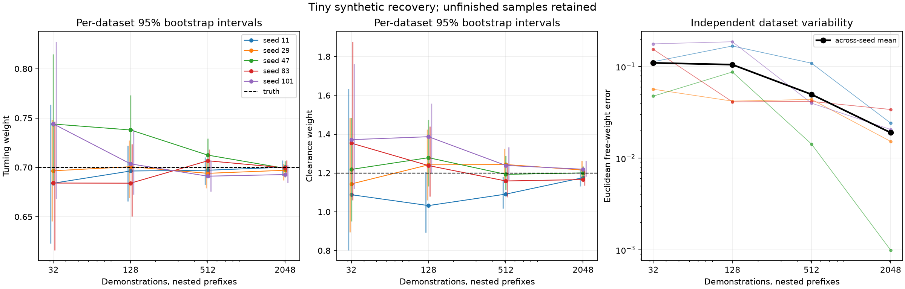

# Wheelchair navigation preference learning

A wheelchair-inspired discrete preference model for studying trade-offs between
distance, turning, and obstacle clearance. It uses exact finite-horizon
maximum-entropy planning and inverse reward learning. It is not a medical device,
a clinical controller, or a model of an actual wheelchair's dynamics.

The research question is whether learned relative costs predict unseen route
choices better than shortest-path or fixed-weight planning. This repository's
current experiments address numerical correctness and tiny synthetic recovery
only. They do not yet answer the unseen-layout prediction question.

## Install and reproduce

Python 3.11 or newer. Dependencies are PyTorch, numpy, matplotlib, and pytest.
The commands below use PowerShell on Windows, from the repository root.

```powershell
python -m venv .venv
.venv\Scripts\python.exe -m pip install -e ".[test]"
.venv\Scripts\python.exe -B -m pytest -q -W error -p no:cacheprovider
.venv\Scripts\python.exe -B -W error scripts/verify_planner.py
.venv\Scripts\python.exe -B -W error scripts/run_tiny_recovery.py --preflight-only
.venv\Scripts\python.exe -B -W error scripts/run_tiny_recovery.py
```

On other platforms, use `.venv/bin/python` instead of `.venv\Scripts\python.exe`.
No GPU, scipy, simulator, or external dataset is required. Exact dependency
versions are recorded in the generated JSON artifacts.

The default experiment runs 2,000 bootstrap refits, plus point fits and a small
regularization sensitivity check. It uses one CPU torch thread. Each completed
dataset/sample-size cell is checkpointed. Repeating the command reuses cells
only when configuration, model-source hashes, dependency versions, and sampled
prefix hashes match. Incompatible outputs require a different `--output` folder;
they are not silently overwritten or substituted.

For a fresh recomputation without reusing the recorded checkpoints, use a new
folder, especially when dependency versions or source bytes differ:

```powershell
.venv\Scripts\python.exe -B -W error scripts/run_tiny_recovery.py --output results/reproduced
```

## Model conventions

- A state is a free cell and one of four or eight headings. Rows increase down,
  columns right. Eight headings are clockwise E, SE, S, SW, W, NW, N, NE.
- Actions are forward, left one heading increment, and right one increment.
  Invalid movement is masked. Diagonals cannot cut occupied corners.
- Every goal heading is absorbing, with exactly one legal zero-cost continuation.
  Entering the goal still pays ordinary incoming costs. Unique padding prevents
  artificial entropy at the goal.
- Cost features are `[distance, turning, clearance]`. Distance is 1 or sqrt(2)
  for forward moves, zero for turns. Turning is absolute rotation in radians.
- Clearance is `max(0, d_safe-d)**2` at the destination of forward and turn
  actions. `d` is Euclidean distance to occupied cell centers; default
  `d_safe=2` grid units. Boundaries are not obstacles. No occupancy means zero
  clearance cost. Goal-source and invalid features are exactly zero.
- Reward is `-w·phi`, temperature 1. Fitting fixes distance weight to 1 and maps
  the two free weights through softplus. This establishes relative cost units,
  not unique psychological preferences.
- Terminal value is zero at a goal and `-M` elsewhere. Every legal length-T
  action-labelled sequence has score `-w·sum(phi)+V_T(s_T)`, conditional on its
  initial state. Its log partition is `V_0(s_0)`.
- A finite M does not enforce completion. Unfinished samples remain in the
  likelihood and saved pools. `arrival_step` is None for unfinished records.

Planning and likelihoods use `torch.float64`. Unsupported numerical scales raise
explicit errors rather than returning misleading probabilities. The supported
domain requires per-action features <= `float64_max/(16*T)` for T>0, and
`M + T*(max_abs_reward+log(3)) <= 1000`. These conservative restrictions preserve
roundoff headroom; this is not arbitrary-magnitude float64 support.

## Numerical evidence

`scripts/verify_planner.py` imports the same verification functions called by the
tests. Machine-generated `results/verification.json` records fixtures, weights,
terminal scores, all comparisons, tolerances, and dependency versions.

- Exhaustive Test A checks every legal action sequence on two short-horizon
  fixtures, including completed and unfinished sequences and terminal scores.
  The eight-heading fixture exercises legal diagonals and reachable corner blocks.
- Test B compares mean NLL gradients with central finite differences and
  empirical minus exact policy-expected features. Physical and regularized
  softplus objectives are checked separately, including `gradcheck`.
- A V0 Hessian check uses the same occupied fixture with single-legal-action goal
  states and a disconnected component. It compares against negative finite
  differences of exact expected features.
- Regression tests cover cancellation at large finite scores, cumulative-feature
  overflow, masked gradients, and unnecessary regularization overflow.

The verified maximum probability errors are `2.220446049250313e-16` for four
headings and `2.886579864025407e-15` for eight headings. The largest exact
expected-feature discrepancy is `9.769962616701378e-15`, against a `1e-10`
tolerance. Physical NLL autograd/finite-difference error is
`2.072100824257461e-11`; autograd versus empirical-minus-expected discrepancy
is zero. The regularized raw-gradient finite-difference error is
`3.625744149360344e-11`. Both gradchecks pass. The Hessian discrepancy is
`7.99957877717361e-11`, below `1e-7`.

## Tiny recovery protocol

The declared fixture is 5x5 with four headings, occupied cells `(1,2)` and `(2,2)`,
start `(2,0,E)`, goal `(2,4)`, horizon 24, M=30, and d_safe=2. Ground truth is
`[1, 0.7, 1.2]`. Dataset seeds are 11, 29, 47, 83, and 101. Sample counts are
32, 128, 512, and 2048, using nested prefixes of each independent unfiltered pool.

Before drawing the final pools, the runner saves `results/recovery_preflight.json`
and requires exact completion >=0.90, free-feature covariance minimum eigenvalue
>=0.1, condition number <=100, and M greater than maximum reachable finishable
cost-to-go plus one. These checks are at the declared reference weights only.
Different fitted weights can exceed the M-scale costs without changing the model
family. A finite penalty is never described as a hard completion constraint.

Fitting uses mean trajectory NLL plus `lambda/2 * sum(w_free**2)`, deterministic
float64 LBFGS, and strong-Wolfe line search. Success requires a finite optimized
objective, raw-gradient infinity norm <=1e-6, fewer than 150 iterations, and both
free physical weights in [1e-3,10]. Failures are named and retained; weights are
never clipped. The gradient criterion includes regularization when lambda>0.

Each seed/count dataset receives 100 whole-trajectory bootstrap refits. Intervals
are the 2.5th and 97.5th NumPy linear percentiles of successful fits only. Failed
refits are counted with reasons. Fewer than 80 successes makes intervals
unreliable. These per-dataset intervals differ from sample standard deviations
across independently generated datasets. Truth-containment counts and asymptotic
standard-deviation comparisons are descriptive, not coverage guarantees.

Primary lambda is zero. Sensitivity uses 0, 0.001, and 0.01 at n=32 and n=2048
for every seed. The zero-lambda result reuses the corresponding primary fit.
The bootstrap base seed is `73001+1000003*dataset_seed+sample_size`; each refit's
resampling seed is saved. No seed or trajectory is selected based on outcomes.

### Generated recovery evidence

The full predeclared run completed. All 20 primary fits, 2,000 bootstrap refits,
and 20 additional positive-lambda sensitivity fits passed the stated convergence
criteria. Ten zero-lambda sensitivity rows reuse primary fits. The largest
iteration count was 14; the largest raw-gradient infinity norm was `2.56e-7`.

All 10,240 unfiltered sampled trajectories completed, so observed completion
is 100% at every prefix. Exact model completion is `0.9999999999965422`, not a
hard guarantee. No unfinished trajectories were discarded; this particular
high-completion run happened to draw none.

The original fixture passed preflight without revision. Covariance eigenvalues
were `1.08459` and `29.90771`, condition number `27.57504`. The free-weight
covariance was approximately `[[29.89436,-0.62023],[-0.62023,1.09795]]`.
Both free directions are locally identified under this model, but clearance is
less informative than turning. This is a local statistical diagnostic, not a
claim of uniquely psychological preferences. Maximum reachable finishable cost
at the reference weights was `12.93400`; `30 > 12.93400 + 1`.

Across the five independent datasets:

| Demos | Turning absolute error, mean | Clearance absolute error, mean | Euclidean error, mean +/- sample std | Turning intervals containing truth | Clearance intervals containing truth |
|---:|---:|---:|---:|---:|---:|
| 32 | 0.024682 | 0.102483 | 0.109860 +/- 0.057570 | 5/5 | 5/5 |
| 128 | 0.012361 | 0.102736 | 0.105128 +/- 0.068947 | 4/5 | 4/5 |
| 512 | 0.007386 | 0.047913 | 0.049759 +/- 0.035250 | 5/5 | 4/5 |
| 2048 | 0.002365 | 0.018563 | 0.019029 +/- 0.012193 | 5/5 | 5/5 |

All 20 datasets had 100/100 successful bootstrap refits, so all reported
intervals passed the 80-success reliability threshold. The containment counts
are descriptive only. Five datasets cannot establish calibrated 95% coverage.
Per-seed estimates, absolute errors, sample standard deviations, and optimizer
diagnostics are retained in the CSV/JSON files rather than only in averages.

At n=2048, the estimates and per-dataset bootstrap intervals were:

| Seed | Turning estimate [95% interval] | Clearance estimate [95% interval] |
|---:|---:|---:|
| 11 | 0.700203 [0.691459, 0.707038] | 1.175797 [1.131131, 1.214432] |
| 29 | 0.697086 [0.686899, 0.703929] | 1.214998 [1.178974, 1.262887] |
| 47 | 0.699044 [0.690195, 0.706309] | 1.200271 [1.173559, 1.234390] |
| 83 | 0.699511 [0.691718, 0.707149] | 1.165938 [1.134691, 1.215624] |
| 101 | 0.692738 [0.684167, 0.702378] | 1.219282 [1.182108, 1.262776] |

Mean Euclidean error improves about 5.77x between n=32 and n=2048. This does
not imply monotonic improvement for each seed or each weight: mean clearance
absolute error is slightly worse at n=128 than at n=32. Descriptive log-log
slopes are -0.5447 for turning absolute error, -0.4248 for clearance absolute
error, and -0.4334 for Euclidean error. These are noisy four-size summaries
from only five independent seeds, not evidence of a proven scaling law.

At n=2048, inverse-covariance asymptotic standard deviations predict `0.004065`
for turning and `0.021213` for clearance. Observed across-seed sample standard
deviations are `0.003014` and `0.023613`. The comparison is descriptive only.

Regularization sensitivity, using the same data and fixed M:

| Demos | Lambda | Mean turning weight | Mean clearance weight | Mean Euclidean error |
|---:|---:|---:|---:|---:|
| 32 | 0 | 0.710533 | 1.235050 | 0.109860 |
| 32 | 0.001 | 0.710484 | 1.233808 | 0.109495 |
| 32 | 0.01 | 0.710041 | 1.222851 | 0.106545 |
| 2048 | 0 | 0.697717 | 1.195257 | 0.019029 |
| 2048 | 0.001 | 0.697670 | 1.194151 | 0.019071 |
| 2048 | 0.01 | 0.697259 | 1.184366 | 0.021117 |

The small L2 penalties shrink the free weights. In these datasets they slightly
reduce mean error at n=32 but increase it at n=2048, particularly through
clearance shrinkage. Lambda=0 was predeclared for the main experiment; it was
not chosen afterward to maximize recovery performance.



Interval stems are offset slightly along the x-axis for readability; all five
datasets still use exactly the declared sample counts. All intervals in this
default run passed the reliability threshold.

Machine-generated evidence files from the runner:

- `results/recovery.json`: complete configuration, diagnostics, point/bootstrap
  fits, intervals, regularization fits, and descriptive summaries.
- `results/recovery_fits.csv`: every seed/count estimate, absolute and Euclidean
  errors, uncertainty, completion, and optimizer diagnostics.
- `results/recovery_bootstrap.csv`: every bootstrap refit, including failures.
- `results/recovery_summary.csv`: across-seed means/sample standard deviations,
  failure counts, and descriptive interval containment.
- `results/recovery_regularization.csv`: every declared sensitivity fit.
- `results/recovery_demos.jsonl`: all unfiltered synthetic demonstration records.
- `results/recovery_cells/`: per-cell raw fit records and resume identities.
- `results/recovery_curve.png`: recovery curves with per-dataset uncertainty.

## Claims and limitations

| Resume target | Status | Evidence or missing work |
|---|---|---|
| Differentiable float64 finite-horizon PyTorch planner | SUPPORTED | `src/wnp/soft_dp.py`, all-state/autograd tests in `tests/test_soft_dp.py` |
| Verified against exhaustive trajectories | SUPPORTED | Both `verify_distribution` fixtures; `results/verification.json` |
| Finite differences and gradient checks | SUPPORTED | `tests/test_irl.py`; shared gradient, gradcheck, and Hessian reports |
| Recovered weights from synthetic AND keyboard demonstrations | PARTIAL, synthetic only | `scripts/run_tiny_recovery.py`, `results/recovery.json`, CSVs, and curve; no keyboard demonstrations exist |
| Route prediction on 100 unseen 20x20 layouts against baselines | UNSUPPORTED | No baselines or generalization experiment implemented |

No human demonstrations have been collected. No 100-layout generalization
experiment has been run. Five synthetic datasets on one tiny layout cannot
establish human preference recovery, generalization, clinical safety, or a
comparison with shortest-path/fixed-weight planning. Log-log error slopes from
only five seeds are noisy descriptive summaries; non-monotonic errors must not
be hidden. Local identifiability is not proof of global psychological uniqueness.

## Withdrawn offered-route development experiment

**The version-1 final protocol is withdrawn.** Its same-distance candidates did
not test the intended preference trade-offs. The following subsection preserves
the historical development result; use the revised experiment below instead.

The next implemented task is **binary choice between two offered completed
routes**, not unrestricted route prediction. It uses the five frozen n=2048,
lambda-zero learned models above, without fitting again. Candidate construction
receives no learned or oracle weights.

Route A minimizes movement distance, then action count, then the action sequence
with forward < left < right. Route B is the best alternative found by forbidding
each undirected movement edge of A in turn. Stable option IDs follow unpadded
action-sequence order. Both routes are padded using the existing unique goal
continuation. Cost ties within 1e-12 predict A without changing probabilities.

For offered-route probabilities, temperature-one log-softmax uses the two
negative route costs. This equals conditioning the existing full trajectory
model on the offered pair. It does not marginalize arbitrary routes or corridor
classes. The deterministic shortest-distance baseline gets accuracy and regret
but no invented likelihood. The soft distance-only comparator is reported
separately from that deterministic baseline.

The approved development settings are 20x20, four headings, occupancy 0.20,
d_safe=2, start (0,0,E), goal (19,19), T=160 and M=200. Seeds are 10000..10009.
Connectivity-conditioned generation records its attempts, with no carving or
replacement seeds. Every development layout is preflighted before any labels
are drawn. Gates require completed legal candidates, the reference terminal
margin, oracle completion >=0.90 and the existing numerical-domain checks for
every probabilistic model. All model completion probabilities are recorded.

Run the development study separately from the tiny-recovery evidence:

```powershell
.venv\Scripts\python.exe -B -W error scripts/run_offered_routes.py --stage development --output results/offered_routes_dev
```

The study completed with **10/10 preflight passes** and 64 shared synthetic
choices per layout. Sampled accuracy is averaged within layouts, across the five
learned models within each layout, and then equally across layouts. Binary Brier
is mean `(P(option1)-label)**2`. Oracle-cost regret is the predicted offered
route's oracle cost minus the minimum offered oracle cost.

| Model | Sampled accuracy | Oracle expected accuracy | Binary NLL | Binary Brier |
|---|---:|---:|---:|---:|
| Learned, mean of five models | 0.815625 | 0.788517 | 0.420345 | 0.133845 |
| Fixed weights [1,1,1] | 0.815625 | 0.788517 | 0.429783 | 0.136291 |
| Deterministic shortest distance | 0.459375 | 0.445321 | Not defined | Not defined |
| Soft distance-only [1,0,0] | 0.459375 | 0.445321 | 0.693147 | 0.250000 |
| Ground-truth oracle | 0.815625 | 0.788517 | 0.420169 | 0.133801 |

These are **development results, not final held-out evidence**. The learned and
fixed models made identical choices on all ten layouts. All ten candidate pairs
had equal movement distance and turning totals; one pair also had equal
clearance cost. Consequently these development choices do not test a trade-off
between turning and clearance. The probability metrics can differ with clearance
weight magnitude even when predicted options agree. Do not interpret these
results as evidence that learning beats the fixed-weight baseline.

The predeclared paired whole-layout bootstrap uses 10,000 resamples, seed 920001,
and 97.5% two-sided linear-percentile intervals for each of two primary accuracy
comparisons. The development learned-minus-shortest accuracy difference is
0.35625 with interval [0.090625,0.6625]; learned-minus-fixed is zero with interval
[0,0]. The criterion for superiority over both baselines is not met. Layout-level
intervals do not quantify training uncertainty. Development intervals cannot
replace evaluation on the untouched final set.

Saved outputs in `results/offered_routes_dev/`:

- `identity.json`: configuration, frozen model records, checkpoint hash,
  dependency versions and relevant source hashes.
- `preflight.json`: layouts, generation attempts, candidates, features and gates,
  persisted before any choice labels.
- `study.json`: shared labels, all model probabilities/predictions, per-layout
  metrics and paired layout-level summaries.
- `integrity.json`: hashes used to reject corrupted or incompatible reruns.
- `final_manifest.json`: sealed final-study configuration, models and source
  identity, awaiting explicit approval. SHA256:
  `3ea13b0bbf743f55180024b609bb032614afc4bf883e326e8965f70f5ffd52cc`.

The historical manifest above is not approved and cannot run against the revised
source identity. No final layouts or labels have been generated. A final study
preflight failure halts labels across the study, without replacing its seed or
changing T/M. Configuration changes after development require explicit review.
Human collection, clinical claims and unrestricted navigation prediction remain
outside this stage.

Post-implementation review found a coordinate-container bug affecting JSON-
restored configurations, not the default run. A failing generator/provenance
regression reproduced it before coordinates and other sequences were normalized
to immutable tuples. The full suite now passes 266 tests. Post-fix development
regeneration reproduced every layout, route, label and result above exactly;
only source provenance changed. Sealing the manifest did not run final layouts.

## Revised competing-cost offered-route experiment

Candidate construction now builds a route library from all six lexicographic
priority orders of distance, turning and clearance. It uses no ground-truth or
learned preference weights. Feature-dominated routes are excluded; offered pairs
must trade an increase in one cost against a decrease in another. Pair selection
maximizes balanced opposing differences after normalization by each feature's
range in the library, with deterministic action-sequence tie-breaks. This finite
library is not the full Pareto frontier of all possible routes.

The shortest-distance baseline now chooses the shortest **offered** route, then
fewer actions, then the action sequence. Neither offered route is claimed to be
the unrestricted shortest path. Other models and metrics are unchanged.

Before drawing development choices, the runner rejects designs that have no
cost opposition, fail to vary each feature on at least 20% of layouts, or fail
to distinguish both free-feature directions. Four predeclared diagnostic
preference profiles must choose differently on at least 20% of layouts. Those
profiles audit the design but never select routes. The runner never requires
learned models to win in order to accept a study.

All ten existing development seeds passed without replacement or further changes:

- Competing costs: **10/10 pairs**.
- Nonzero distance differences: **5/10**; turning: **10/10**; clearance: **10/10**.
- Both free-feature directions distinguishable; normalized design minimum
  eigenvalue `0.029744`, condition number `66.2408`.
- Diagnostic preferences produce different choices on **10/10** layouts.

| Model | Sampled accuracy | Oracle expected accuracy | Binary NLL | Binary Brier |
|---|---:|---:|---:|---:|
| Learned, mean of five | 0.854688 | 0.835287 | 0.344098 | 0.105605 |
| Fixed weights [1,1,1] | 0.857813 | 0.822557 | 0.601549 | 0.135616 |
| Offered-pair shortest distance | 0.857813 | 0.822557 | Not defined | Not defined |
| Soft distance-only | 0.857813 | 0.822557 | 0.474160 | 0.159276 |
| Oracle | 0.854688 | 0.835287 | 0.343474 | 0.105335 |

Learned and fixed weights now disagree on one layout. The learned prediction
agrees with the oracle's more probable option there, but finite sampled choices
favor the other option. Consequently learned sampled accuracy is slightly worse,
despite better oracle expected accuracy and probability scores. Accuracy remains
the predeclared primary metric. The learned-minus-fixed accuracy difference is
`-0.003125`, with adjusted layout-bootstrap interval `[-0.009375,0]`. This is
not a superiority result; we do not change the primary metric or hide that fact.

These are development outcomes on previously inspected layout seeds, not fresh
held-out evidence. The correction makes the task capable of distinguishing
preferences; it does not guarantee a learned-model win. Synthetic choices also
do not establish human preference prediction.

```powershell
.venv\Scripts\python.exe -B -W error scripts/run_offered_routes.py --stage development --output results/offered_routes_tradeoffs_dev
```

Revised outputs use `results/offered_routes_tradeoffs_dev/`. The original
development artifacts remain untouched at `results/offered_routes_dev/`.
Post-implementation review found and reproduced a rounded path-ordering bug and
missing construction evidence on candidate failure. Search now accumulates the
stored binary feature values exactly using integer-scaled keys, while planning
and likelihoods remain float64. Failure records retain every recipe and library.
All 60 regenerated development recipes matched an independent reverse-graph
Fraction-arithmetic audit, including action ties. The suite passes 279 tests.

The revised final manifest is
`results/offered_routes_tradeoffs_dev/final_manifest.json`, SHA256
`f3efd131512cfb4a6ad92b19fa1e0b5cba11d687b0446bceb50187f03cb74b06`.
The final set remains ungenerated. This revised manifest is sealed but still
requires explicit approval before execution.
